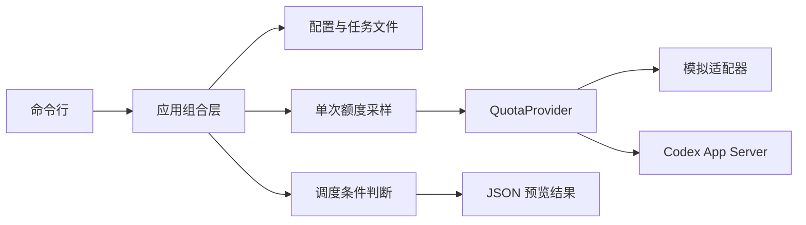

# 架构与模块约定

## 技术选择

使用 TypeScript 严格模式与 Node.js 内置库。当前一个 npm 项目即可承载模块，暂不拆分多个包。
领域模型、接口与具体外部实现分离。后续界面调用应用层，不直接连接 Codex 协议。

## 当前数据流

当前 preview 不创建任务运行、不消费队列、不调用执行器。多次预览可能返回同一个候选任务。

## 真实读取连接

`launcher.ts` 从 PATH 或配置路径发现 CLI，校验 `--version`，处理原生可执行文件及标准 npm Windows 启动器。
`rpc-client.ts` 通过独立子进程的 stdio 连接 App Server，处理 JSONL 分帧、请求 ID 匹配、超时和连接关闭。
所有启动参数以数组传入，不拼接 shell 命令。stderr 被消费但不对外输出，RPC 原始错误只用于分类。

`AppServerQuotaProvider.read()` 每次创建短连接，按顺序发送 initialize、initialized、
account/read（refreshToken=false）、account/rateLimits/read。成功或失败均在 finally 中回收子进程。
缺少登录、非 ChatGPT 登录、未知协议和网络错误分别返回稳定错误码，绝不回退为模拟数据。
工作区 ID 只采信接口实际返回的信息，不从邮箱或套餐推断。

采集时间在收到额度响应后生成。每次查询重新读取账户，避免缓存旧账户状态；以后持续监控可复用底层连接，
但需要另行实现更新通知、账户变化、取消与退避逻辑。

## 稳定接口

- `QuotaProvider.read()`：返回标准化 `QuotaSnapshot`，不泄露认证令牌。
- `QuotaSnapshot`：保留来源、采集时间和多个额度桶；窗口按实际分钟数识别。
- `TaskDefinition`：保存指令位置、项目、优先级和会话意图。
- `TaskExecutor.execute()`：接收指令快照与取消信号，返回 `TaskRun`。
- `TaskRepository` / `RunRepository`：分别管理任务定义和运行历史。
- `Clock`：业务逻辑可使用固定时间测试，避免依赖真实等待。
- `Notifier`：预留本地通知实现。

协议返回先经 adapters/codex/normalize-quota.ts 转换，调度器只使用领域模型。
`null` 表示未知，不能转换成零消耗或额度已刷新。没有返回五小时窗口时不补造窗口。
各额度桶不合并，当前只检查配置指定的桶及其所有返回窗口。

## 后续执行流程

1. 获取新鲜额度并核对当前账户、工作区及限制桶。
2. 从持久化队列选取候选任务，确认当前没有运行中的冲突任务。
3. 原子取得任务执行权，保存指令快照与提交标识。
4. 调用执行器，持续保存会话 ID、事件与结果。
5. 成功、失败、取消或需要人工处理均落盘；每次新提交前重新核对额度。

刷新识别独立于“当前额度可用”判断。必须依据新的服务端快照，不能仅按本地时间加五小时。
服务端未支持幂等提交时，不承诺端到端恰好一次。提交后崩溃造成结果不明时，需要先核对会话，无法核对则进入 needs_attention。

## 持久化与界面

当前内存仓储用于开发，会随进程退出丢失；示例 JSON 是可手动维护的任务定义。
第二阶段先确定数据模型、迁移和事务要求，再引入 SQLite 等持久化实现。
后台服务、管理界面、托盘与通知放在后续阶段，复用同一应用层。
