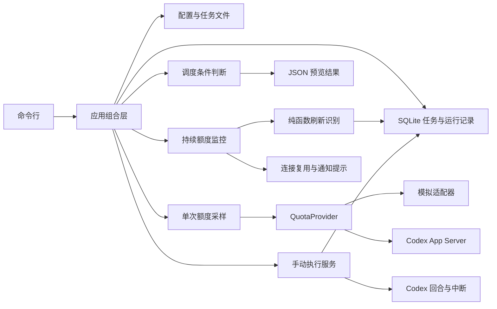

# 架构与模块约定

## 技术选择

使用 TypeScript 严格模式与 Node.js 内置库。当前一个 npm 项目即可承载模块，暂不拆分多个包。
领域模型、接口与具体外部实现分离。后续界面调用应用层，不直接连接 Codex 协议。

## 当前数据流

当前 preview 不创建任务运行、不消费队列、不调用执行器。多次预览可能返回同一个候选任务。

## 真实读取连接

`launcher.ts` 从 PATH 或配置路径发现 CLI，校验 `--version`，处理原生可执行文件及标准 npm Windows 启动器。
`rpc-client.ts` 通过独立子进程的 stdio 连接 App Server，处理 JSONL 分帧、请求 ID 匹配、超时和连接关闭。
所有启动参数以数组传入，不拼接 shell 命令。stderr 被消费但不对外输出，RPC 原始错误只用于分类。

`AppServerQuotaProvider.read()` 每次创建短连接，按顺序发送 initialize、initialized、
account/read（refreshToken=false）、account/rateLimits/read。成功或失败均在 finally 中回收子进程。
缺少登录、非 ChatGPT 登录、未知协议和网络错误分别返回稳定错误码，绝不回退为模拟数据。
工作区 ID 只采信接口实际返回的信息，不从邮箱或套餐推断。

采集时间在收到额度响应后生成。status 保持独立短连接；持续监控使用 AppServerQuotaFeed 复用连接，
每次完整查询前后读取账户并比较；更新通知是重读提示，不直接替换快照。重复套餐通知不等于身份变化。

## 稳定接口

- `QuotaProvider.read()`：返回标准化 `QuotaSnapshot`，不泄露认证令牌。
- `QuotaSnapshot`：保留来源、采集时间和多个额度桶；窗口按实际分钟数识别。
- `TaskDefinition`：保存指令位置、项目、优先级和会话意图。
- `TaskExecutor.execute()`：接收持久化运行快照、取消信号与事件接收器，返回 `ExecutionOutcome`；运行状态由应用层落盘。
- `TaskRepository` / `RunRepository`：分别管理版本化任务定义、不可变快照和运行状态。
- `Clock`：业务逻辑可使用固定时间测试，避免依赖真实等待。
- `Notifier`：预留本地通知实现。

协议返回先经 adapters/codex/normalize-quota.ts 转换，调度器只使用领域模型。
`null` 表示未知，不能转换成零消耗或额度已刷新。没有返回五小时窗口时不补造窗口。
各额度桶不合并，当前只检查配置指定的桶及其所有返回窗口。

## 后续执行流程

1. 获取新鲜额度并核对当前账户、工作区及限制桶。
2. 从持久化队列选取候选任务，确认当前没有运行中的冲突任务。
3. 原子取得任务执行权，保存指令快照与提交标识。
4. 调用执行器，持续保存会话 ID、事件与结果。
5. 成功、失败、取消或需要人工处理均落盘；每次新提交前重新核对额度。

刷新识别独立于“当前额度可用”判断。必须依据新的服务端快照，不能仅按本地时间加五小时。
服务端未支持幂等提交时，不承诺端到端恰好一次。提交后崩溃造成结果不明时，需要先核对会话，无法核对则进入 needs_attention。

## 持久化与界面

SQLite 使用 Node 内置 node:sqlite，无第三方运行时依赖；npm 脚本为 Node 22.12 设置必要的实验参数。
Database 统一管理事务、迁移、完整性检查与 VACUUM INTO 备份；任务和运行记录分别由仓储封装。
数据库以 application_id 标识，拒绝打开已知的其他应用数据库。schema 版本使用 PRAGMA user_version，
当前版本 4；升级事务内重读版本，迁移失败回滚，不自动重置数据。

tasks 保存当前定义与指令，task_versions 保存每次编辑的定义和指令快照；runs 保存准备运行时的版本、
完整定义、指令、SHA-256 和运行状态。修改或归档任务不改变旧运行记录。归档的 ID 保留，不允许被新任务复用。
任务编辑通过预期 revision 防止丢失更新，批量导入与版本写入使用同一事务。
首次导入标记随数据一起持久化，防止重启时恢复已归档任务。

配置仍使用独立 JSON 文件。ConfigManager 在写锁内校验、保存上一个有效版本到 .bak，
再将同目录临时文件 fsync 后原子替换。读取不要求写锁；写冲突明确返回 CONFIG_BUSY。
配置与数据库是两个独立持久化单元，不提供跨文件事务。路径在配置/任务文件位置解析，数据库中保留绝对路径。

应用只在需要任务数据时打开数据库，status 不依赖 SQLite 连接；CLI finally 关闭连接。
demo 强制使用模拟额度与内存数据库；任务管理命令不触发真实额度查询或任务执行。

## 手动执行

ManualExecutionService 原子地创建运行记录并取得 execution_lock，或只取得已有 queued/waiting_quota 记录的执行权。
一份数据库同时只允许一个执行者；重复启动已运行记录被拒绝。正常保存结束状态后释放执行权，落盘失败保留锁用于核对。
取消标记存在 execution_lock，由执行进程定期读取；Ctrl+C、超时同样通过 AbortSignal 传递。

CodexExecutor 用同一 App Server 连接检查账户/额度、创建或续接会话，再核对账户并启动回合。
源码中的枚举以实测版本生成的 Schema 为准：thread sandbox 使用 read-only/workspace-write，approvalPolicy 使用 on-request，
turn sandboxPolicy 则使用 readOnly/workspaceWrite。服务端实际生效的策略仍受 Codex 的托管限制约束。

turn-runner 隔离通知与反向请求处理，缓存早于 turn/start 响应的事件，严格匹配 threadId/turnId。
agentMessage 完成项为最终文本依据，turn/completed 才能确定回合终态；interrupt RPC 成功不等同于任务已停止。
收到审批或输入请求时请求停止，保存 needs_attention；连接断开或提交响应丢失时同样不能自动重发。
execution_events 只记录所需的生命周期元数据，不保存原始审批参数、原始错误和推理内容。
运行最终输出保存在 runs 中；流式部分输出定期保存，任务和指令快照不变。

## 持续监控

ContinuousQuotaMonitor 负责串行采样、等待、通知合并、失败退避和取消；时钟与等待器可注入。
recognize 是纯状态转换，分别输出窗口刷新事件和可用性变化，不依赖 CLI 或任务执行器。
domain/quota-policy.ts 的可用性判断同时供监控、调度预览和手动执行复用。

SqliteMonitorRepository 在同步事务内读取旧检查点、识别变化、插入去重标识及事件、保存新检查点。
每个来源/连接配置/额度策略形成独立监控流；账户或套餐变化重建窗口基线。
事件明细保留最近 1000 条；刷新去重键独立保留，清理历史不会重新发出旧事件。
离线 status 重新检查快照年龄与窗口截止时间，历史可用不等于现在可用。
监控的运行范围、刷新证据和保守识别边界见 MONITORING.md。

后台服务、管理界面、托盘与本地通知放在后续阶段，复用同一应用层。
