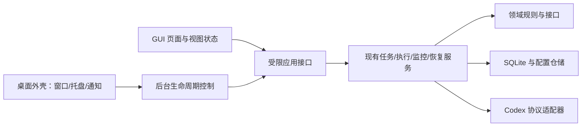

# 桌面客户端需求文档

版本：v0.1 草案；日期：2026-10-25；项目：Codex Quota Scheduler。
状态：最小客户端、后台生命周期、GUI 框架/概览、任务/队列及记录/异常处理已实现；配置帮助向导、托盘、安装器与迁移继续分块推进。

## 1. 产品目标与首版假设

将现有本机管理页面与后台服务包装为可以安装、双击启动的桌面客户端。用户通过 GUI 完成额度查看、任务编排、队列调度、结果查看及异常处理，日常操作无需打开终端。

首版按以下范围设计，作为开发基线：

- Windows 桌面优先，首个验收平台拟定为 Windows 11 x64；其他系统及架构后续单独验证。
- 单个活动 Codex 账户、多个项目目录、单任务串行执行；不增加账户池或并行派发。
- 默认中文界面，保留明确的状态和错误代码，方便定位问题。
- 任务、配置与历史保存在本机；无云端账号系统、云同步或远程调度服务。
- 安装包自带运行本项目所需的运行时，终端用户无需安装 Node.js、npm 或编译项目。
- 真实执行仍依赖用户本机可用的 Codex CLI 与其登录状态。客户端提供检测和操作引导，不收集账户密码，不承诺自动安装或自动登录。

窗口尺寸、交互样式和首个平台属于产品方案，可在实现前调整；额度判断、执行互斥和恢复保护属于不可削弱的项目约束。

## 2. 现有能力与本期增量

| 能力 | 当前状态 | 桌面客户端要求 |
| --- | --- | --- |
| 真实额度、监控与刷新识别 | 已实现 | 复用，新增桌面展示与状态通知 |
| 任务版本、快照和 SQLite 持久化 | 已实现 | 复用，改善编辑、目录选择及查找体验 |
| 手动执行与自动队列 | 已实现 | 复用执行权、账户检查与调度规则 |
| 异常检测、只读核对与显式恢复 | 已实现 | 复用，提供清晰的逐步处理界面 |
| 本机网页、前后台服务与日志 | 已实现；桌面生命周期管理已接通 | 继续作为页面改造和安装运行基础 |
| 独立桌面窗口、托盘、系统通知 | 最小窗口已实现；托盘/通知待实现 | 继续补齐桌面生命周期与通知 |
| 自带运行时的安装包 | 桌面便携目录已实现；安装器待实现 | 桌面便携版无需另装 Node.js；原 CLI 便携目录仍需 Node.js |
| 老数据导入、安装升级、卸载策略 | 待实现 | 本期新增，保留既有数据及审计记录 |
| 登录后启动客户端 | 待实现 | 后续增强，默认关闭；不自动恢复派发 |

## 3. 页面结构与视觉方向

采用左侧固定导航、顶部全局状态、右侧主要工作区。常用状态直接可见，高风险操作在靠近对应任务的位置显示作用范围。

```text
┌──────────────────────────────────────────────────────────────┐
│ Codex 任务助手   模拟/真实 · 账户状态 · 服务状态   通知 / 设置 │
├──────────┬───────────────────────────────────────────────────┤
│ 运行概览 │ 额度窗口卡片       队列状态       当前运行          │
│ 任务管理 │                                                   │
│ 调度队列 │ 当前页面内容：列表 / 编辑器 / 输出 / 异常处理        │
│ 运行记录 │                                                   │
│ 异常处理 │                                                   │
│ 设置帮助 │ 最近查询时间 · 数据新鲜度 · 连接状态                │
└──────────┴───────────────────────────────────────────────────┘
```

- 初始窗口建议 1200×800，最小可用布局目标 960×640；小屏幕和高缩放下允许纵向滚动，关键按钮不能被遮挡。
- 使用简洁的工具型界面：清晰标题、短说明、表格与状态标签，输出区使用等宽字体。
- 状态同时使用文字和颜色：成功/可用、等待/暂停、失败/待核对、未知/离线；不能只靠颜色区分。
- 首版提供一套一致的浅色主题；深色主题列为后续增强，不阻塞核心交付。
- 账户信息默认脱敏；模拟模式采用持续可见的标记，不能与真实额度混淆。
- 任务编辑采用宽面板或独立详情页，避免把长指令挤在小弹窗内。
- 支持键盘导航、明确焦点、可读控件标签；弹窗关闭后恢复焦点到发起控件。

### 页面需求

| 页面 | 必须显示 | 核心操作 |
| --- | --- | --- |
| 运行概览 | 数据来源、账户状态、全部服务端额度窗口、最后查询时间、未知/阻塞原因、当前任务、队列摘要 | 查询额度、开启/停止监控、查看当前运行、进入异常处理 |
| 任务管理 | 名称、项目目录、启用状态、版本、优先级；支持按名称/项目筛选 | 新建、编辑、归档、加入队列、手动执行、选择项目文件夹 |
| 调度队列 | 快照版本、优先级、入队顺序、状态、等待原因、调度进程状态、触发模式 | 启动调度、恢复/暂停派发、移除未领取记录、查看快照 |
| 运行记录 | 时间、任务、项目、状态；分页与状态筛选 | 查看最终/部分输出、事件、不可变指令快照，复制输出，请求取消 |
| 异常处理 | 待核对记录、错误说明、原会话/回合标识、遗留执行权、核对结果 | 只读核对、应用已确认结果、显式修复、人工确认已核对 |
| 设置与帮助 | 活动配置、待生效配置、CLI/客户端版本、数据位置、日志、使用说明 | 校验保存、受控重启、备份/恢复向导、打开数据目录、诊断导出 |

## 4. 功能需求与优先级

P0 为首版交付必需，P1 为后续增强；标为“复用”的能力也需通过桌面端验收。

| 编号 | 优先级 | 需求 | 验收要点 |
| --- | --- | --- | --- |
| D01 | P0 | 独立窗口与单实例 | 双击启动无需终端；重复启动唤起既有窗口，同一配置不产生第二个调度服务 |
| D02 | P0 | 首次使用引导 | 可选择模拟体验、接入现有配置或配置真实连接；缺少 CLI/登录时明确说明阻塞原因 |
| D03 | P0 | 额度概览 | 显示服务端实际窗口；缺失、过期和断线显示未知；倒计时结束只触发查询 |
| D04 | P0 | 任务编辑 | 提供目录选择器及指令编辑区；字段校验；revision 冲突保留用户草稿并提示重新加载 |
| D05 | P0 | 快照入队 | 编辑任务不会修改旧快照；入队前显示版本、项目、权限；同一版本重复入队不产生重复任务 |
| D06 | P0 | 调度控制 | 默认暂停，只有显式恢复后派发；暂停队列与停止调度具有不同按钮和说明 |
| D07 | P0 | 手动运行与取消 | 执行使用持久化快照；与自动调度共用互斥；取消未确认时显示“取消中/待核对” |
| D08 | P0 | 记录与输出 | 输出可复制、可选择；列表分页；更新时保留用户阅读位置，切换记录不会展示旧请求结果 |
| D09 | P0 | 异常处理流程 | 显示建议下一步；不自动重发、解锁或批准输入；核对严格限定已记录来源与准确回合 |
| D10 | P0 | 托盘与窗口关闭 | 关闭窗口默认转入托盘并首次说明；托盘可以打开窗口、查看状态、暂停派发和安全退出 |
| D11 | P0 | 系统通知 | 通知任务终态、需要人工处理、登录失效或持续连接故障；同一问题不重复轰炸 |
| D12 | P0 | 配置和诊断 | 校验保存、有效备份、原子替换；连接/数据库设置重启生效；诊断导出默认排除敏感正文 |
| D13 | P0 | 安装与数据迁移 | 安装包自带运行时；安装目录与用户数据分离；显式导入旧配置/数据库且不改写原件 |
| D14 | P0 | 安全退出与升级 | 停止接收新操作、暂停派发、等待结果保存后退出；升级不打断未确认提交，不默认清空数据 |
| D15 | P0 | 使用说明 | 客户端内可打开本地帮助，覆盖首次配置、入队、暂停、取消、恢复、备份和卸载 |
| D16 | P1 | 登录后启动 | 用户主动启用；登录后可最小化到托盘，只启动客户端/监控，队列仍暂停 |
| D17 | P1 | 检查与安装更新 | 用户选择检查/下载/安装；显示版本与变更；验证发布产物完整性，执行中延后升级 |
| D18 | P1 | 体验增强 | 深色主题、任务模板、批量编辑、通知静默时段及更多筛选条件 |

### 任务编辑字段

必填项：任务名称、任务 ID、项目目录、指令。任务 ID 创建后保持稳定。

其他字段：启用状态、优先级、可选模型、超时、只读/工作区写入权限、新会话/指定既有会话、可选推理配置。模型与协议选项不得凭空填入或硬编码为固定账户可用能力。

默认只读。选择工作区写入时明确显示允许写入的项目目录。普通编辑保存不执行任务，执行与入队使用独立按钮。

### 通知规则

- 默认通知：任务成功/失败、需要人工核对、明确登录失效、持续服务故障及其恢复。
- 额度窗口刷新可配置为通知；必须基于完整查询确认的刷新事件，不能由倒计时结束触发。
- 正常轮询、剩余比例微小变化、未变化的断线状态不重复通知。
- 默认通知文案只包含概括状态，不展示指令、输出、邮箱或完整目录；点击后进入客户端对应记录。
- 通知被系统禁用时，客户端内仍有可查的事件和状态，不影响调度规则。

## 5. 关键流程与状态语义

### 5.1 首次启动

安装 → 启动窗口 → 初始化用户数据目录 → 选择模拟体验或真实配置 → 检测依赖与账户 → 进入概览。

默认允许先使用模拟模式。真实配置验证失败时保留草稿并说明原因，不能悄悄切换模拟来源来假装连接成功。已有数据库损坏时进入恢复引导，不新建空库覆盖。

### 5.2 自动执行

新建并保存任务 → 预览版本快照 → 显式加入队列 → 启动调度进程 → 用户恢复派发 → 完整查询确认额度与账户 → 串行领取并执行 → 保存结果。

服务端窗口、其他额度限制和保留阈值共同决定是否可用。客户端只展示核心服务的判定，不在页面中另写一套可用性算法。

### 5.3 关闭、暂停与退出

| 操作 | 窗口 | 后台与当前任务 | 后续派发 |
| --- | --- | --- | --- |
| 最小化/关闭窗口到托盘 | 隐藏 | 继续运行 | 保持原状态 |
| 暂停队列 | 保持打开 | 当前任务继续完成 | 停止领取新任务 |
| 请求取消任务 | 保持打开 | 请求中断，等待准确回合终止确认 | 按队列与异常保护规则判断，不自动重发被取消记录 |
| 停止调度进程 | 保持打开 | 请求停止该进程负责的执行并等待落盘 | 停止派发 |
| 安全退出客户端 | 显示退出进度后关闭 | 先暂停并停止自有服务，等待执行结果保存；结果不明落盘为待核对 | 停止派发 |
| 系统强制结束/断电 | 无法保证正常关闭 | 下次启动检测遗留状态 | 保持暂停，人工核对后才能恢复 |

活动任务存在时，退出面板提供“留在托盘”“暂停队列并等待当前任务结束后退出”“请求取消并退出”。后两项都先暂停派发；在结果保存完成前，不能显示“已安全退出”。

启动时发现现有 CLI 服务，先验证其身份并显示“连接已有服务”。桌面端仅隐藏或断开窗口不能停止该外部服务；停止它需用户显式选择。服务归属必须记录清楚。

托盘不可用时，关闭窗口不能让仍在运行的服务变成无法发现的后台进程，应提示用户选择继续保留窗口或安全退出。

### 5.4 异常与重启

重启 → 检查服务实例和数据库执行权 → 展示正常/待核对/损坏状态 → 用户选择只读核对或显式修复 → 应用已确认结果 → 用户明确恢复队列。

网络恢复或系统唤醒后先完整查询；服务重启默认暂停。仅窗口重新打开不会改变仍正常运行的后台队列状态。

审批或补充输入需要人工处理，首版不提供自动批准或猜测答案。证据不足、回合找不到或账户不匹配时维持 needs_attention。

## 6. 安装、存储与升级要求

### 安装交付

- 首版提供 Windows 安装包；是否增加免安装压缩包作为构建阶段的可选交付。
- 默认按当前用户安装；不注册需要管理员权限的系统服务。
- 可创建开始菜单入口，桌面快捷方式由用户选择；日常运行不弹出终端窗口。
- 安装包包含本项目后端、页面、桌面外壳和兼容运行时，不包含登录凭据、个人任务或测试记录。
- 发布构建提供版本号、变更说明和校验信息；正式公开分发前确定签名与发布渠道，不将签名证书假定为已具备。

### 数据位置与迁移

- 客户端数据使用系统提供的当前用户应用数据目录，不写入程序安装目录或源码目录。
- 分别管理配置、SQLite 数据库、备份、轮转日志和实例状态；可在设置中查看位置。
- 旧项目首次导入必须预检配置、数据库版本、文件权限和活动进程；需要一致性快照时使用现有备份能力，不直接复制活动数据库文件。
- 导入前展示来源与目标，先备份再转换；保留任务版本、运行快照、账户来源证据、事件和去重标识。
- 原配置中的相对路径必须按原位置解析，再转换为目标配置中可正确定位的路径；不能因移动配置而改变项目或指令位置。
- 导入发现已有目标数据时拒绝静默覆盖，首版不实现自动合库；导入后保持暂停。
- 迁移失败保留源数据与失败信息；数据库损坏时不能自动重建。备份恢复需明确显示会覆盖的目标和备份时间。

### 升级与卸载

- 首版支持手动安装新版本；客户端版本与数据模式版本分别管理。
- 升级前检测执行/恢复操作、暂停派发并完成备份；迁移失败应恢复可启动状态或清晰进入人工恢复流程。
- 不允许旧版本直接写入更高版本的数据库；如需回退，使用匹配备份并明确可能丢失备份之后的记录。
- 卸载默认保留用户数据。删除数据须单独选择并明确确认；不删除 Codex 登录目录、用户项目或外部 CLI。

## 7. 架构与安全要求

复用现有 TypeScript 核心，桌面外壳只负责窗口、托盘、通知、原生目录选择、单实例和安装生命周期。



- 调度器只依赖领域接口；额度、领取、执行权、去重和恢复规则继续在核心服务实现。
- 前端按额度、任务、队列、运行、恢复、设置视图拆分，公共请求和状态组件单独维护；新增逻辑采用严格类型检查。
- 页面不得直接读写 SQLite、访问凭据、执行任意系统命令或取得后台控制密钥。
- 如复用本机 HTTP，仍仅绑定回环地址，保留会话、Origin、CSRF 和请求大小校验；如引入 IPC，限定方法、参数和可信调用来源，不能形成绕过校验的第二入口。
- 只加载受信任的本地页面；外部链接交给默认浏览器，经校验后打开，不在具有本机权限的窗口中加载任意远端页面。
- 日志与诊断包默认不包含登录凭据、原始指令、输出、完整个人路径或账户信息。主动导出运行正文应单独操作并明确内容范围。
- 已通过小型验证选择 Electron，内置运行时、SQLite、子进程回收与便携打包见 [技术决策](DESKTOP-TECH-DECISION.md)。托盘、签名和安装升级仍需对应模块验证。
- 新增真实 Codex 协议功能前核对官方文档及本机版本，不以桌面包装为由扩大现有授权范围。

## 8. 非功能需求与验收环境

以下为验收目标，不是现有测量结果：

| 维度 | 要求 |
| --- | --- |
| 启动体验 | 在记录配置的测试机上，正常冷启动至可操作窗口目标 ≤ 5 秒；远端查询异步进行，不阻塞窗口出现 |
| 操作反馈 | 按钮点击后目标 200 ms 内显示忙碌/受理反馈；长任务展示后台状态，不让界面卡死 |
| 数据量 | 使用至少 1,000 个任务、10,000 条运行记录进行分页/筛选基准；列表目标 ≤ 1 秒，记录测试机和数据大小 |
| 长期运行 | 模拟环境连续运行至少 24 小时，覆盖重复查询和通知，不能重复派发、持续无界增长或泄漏子进程 |
| 显示与输入 | 在 100%、150%、200% 缩放及中文/空格目录下验证；指令区与输出区不截断可操作内容 |
| 故障恢复 | 覆盖断网、登录失效、休眠唤醒、端口占用、进程崩溃、写入失败、数据库损坏及升级中断 |
| 数据一致性 | UI、CLI 与调度同时操作时保持版本冲突检测、执行互斥和快照不可变 |
| 隐私 | 默认无使用行为遥测；通知脱敏；安装产物与诊断导出进行敏感文件检查 |

## 9. 首版验收清单

- [ ] 未安装 Node.js/npm 的目标 Windows 测试环境可以安装并打开模拟模式。
- [ ] Codex CLI 缺失或未登录时有明确引导，仍可编辑任务和使用模拟体验。
- [ ] 重复启动唤起同一窗口；重启服务后队列暂停，未发生自动重发。
- [ ] 模拟模式的所有真实执行入口均被核心服务拒绝，不仅是按钮禁用。
- [ ] 缺失窗口、未知身份、过期额度和周额度耗尽均不能触发派发。
- [ ] 任务编辑、revision 冲突、入队快照和手动/自动互斥通过端到端测试。
- [ ] 关闭到托盘后任务继续；暂停只停止领取；取消等待确认；安全退出等待落盘。
- [ ] 结果不明、审批请求和断线提交保留 needs_attention，恢复只读定位准确回合。
- [ ] 通知可关闭，重复事件去重，默认不泄露账户、指令和输出。
- [ ] 旧数据导入保留历史并正确解析相对路径；失败不损坏源库。
- [ ] 安装升级、迁移失败和卸载保留数据流程可复现。
- [ ] 既有 `npm run check`、`npm test`、`npm run demo` 通过；新增桌面生命周期与交互测试通过。
- [ ] 打包后进行独立安装验收；真实账户执行验收须使用用户明确指定的测试任务与目录，模拟测试不替代真实验收声明。

## 10. 分块实施顺序

| 阶段 | 交付物 | 完成条件 |
| --- | --- | --- |
| A：桌面运行验证 | 框架技术决策、最小独立窗口、后台服务连接、自带运行时样包 | 在干净 Windows 环境打开模拟概览，验证 SQLite 与单实例 |
| B：界面模块化 | 导航、概览、任务编辑、队列、记录、恢复和设置视图 | 全部现有核心流程可通过桌面操作，模块边界与回归测试通过 |
| C：桌面生命周期 | 托盘、通知、服务归属、退出状态、系统唤醒处理 | 关闭窗口不丢任务，安全退出与崩溃恢复验收通过 |
| D：安装与迁移 | 安装包、数据目录、导入/备份向导、手动升级及卸载策略 | 旧版本数据与干净安装场景均通过 |
| E：发布验收 | 本地使用说明、测试报告、版本说明、可分发产物 | P0 清单全部完成，已知限制明确记录 |
| F：后续增强 | 登录后启动、更新检查、主题和模板 | 按独立需求实施，不改变初始暂停和显式派发原则 |

首个代码模块应从阶段 A 的桌面外壳与后台生命周期接口开始；先验证可打包、可启动、可关闭，再逐页完善 GUI。

## 11. 本期不包含

云端部署、远程多用户控制、账户池、多任务并发、自动回答审批、自动重发不明任务、绕过订阅额度限制，以及通过时间推算伪造额度恢复。

不承诺任意既有 Codex 桌面聊天均可续接；继续按当前 CLI/协议能力和已保存的会话证据处理。

关联文档：[当前需求](REQUIREMENTS.md)、[现有管理界面](MANAGEMENT.md)、[架构](ARCHITECTURE.md)、[路线图](ROADMAP.md)、[代码审查](CODE-REVIEW.md)。
