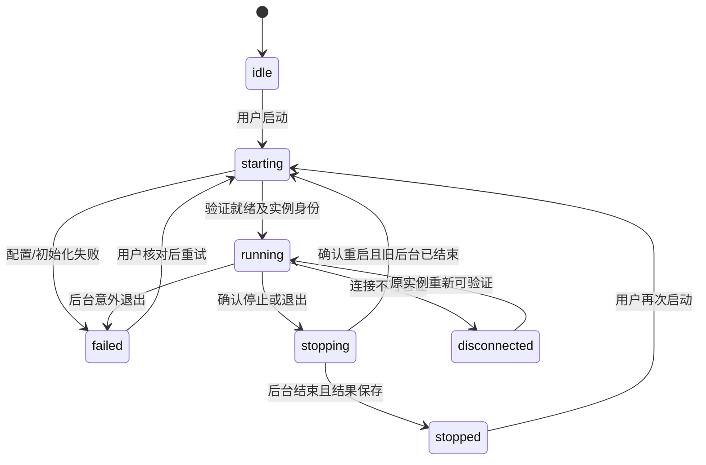

# 桌面后台生命周期管理

日期：2026-10-25。范围：启动/重试、单实例、服务归属、受控重启/停止、安全退出与异常呈现。
依赖现有最小桌面客户端；本模块不引入托盘、自动更新、自动修复或自动重发。

## 使用方法

启动客户端后，菜单“后台服务”可打开服务状态窗口、重试连接、重启或停止自有后台。
新建配置仍是空任务模拟环境。真实任务继续使用持久化快照和原执行权保护。

| 操作 | 当前任务 | 后续派发及进程 |
| --- | --- | --- |
| 继续保留窗口 | 继续 | 原派发状态不变 |
| 等待完成后退出/重启/停止 | 继续并保存结果 | 立即暂停派发、拒绝新写操作，完成后再停止 |
| 请求取消后退出/重启/停止 | 请求中断，等待准确回合终态 | 未确认则保存 needs_attention，结果落盘后停止 |
| 等待期间改为请求取消 | 显式升级为取消 | 不重复创建关闭流程，不强杀进程 |
| 关闭连接外部服务的客户端 | 外部任务继续 | 仅断开客户端，不改变外部队列 |
| 确认停止外部服务 | 按等待/取消选择处理 | 影响它的其他连接，需要单独确认 |

重启必须等待旧后台完全结束后才读取保存的配置；启动后队列保持暂停，不恢复未知提交。
停止自有后台后保留服务状态窗口，用户可再次启动。只有启动/恢复连接才会重新显示管理页面。
未升级的旧后台若缺少生命周期控制字段，报告 RUNTIME_INCOMPATIBLE，不静默猜测其停止状态。

## 状态与异常



- 启动、停止、重启互斥；重复请求报告忙碌，不创建第二个后台。
- 健康检查及系统唤醒只核对已记录实例，不自动重启、抢占或重发；额度新鲜度仍由核心服务判断。
- 后台故障保留客户端状态窗口。未知或过期状态不能被当作正常空闲退出。
- 已确认 PID 退出时可选择核对服务记录；确认后才调用原 recoverInstance，并在写锁内重验 PID。
- 服务记录核对仅处理实例文件；数据库执行权与原回合结果仍须使用既有恢复模块，不自动清除。
- 实例 ID、PID 或地址变化时拒绝控制。损坏记录与无法确认退出的进程保持原状。
- 操作系统强制结束或断电可能打断收尾；下次启动按原恢复规则处理，不声称远端已取消。

## 模块与安全边界

- domain/lifecycle.ts：状态、控制命令、停止模式及 BackendSession 接口。
- desktop/lifecycle.ts：可注入后端的状态协调，不依赖 Electron 或数据库。
- desktop/backend.ts：固定来源的后台连接与身份校验、自有/外部服务停止。
- adapters/electron/lifecycle-ipc.ts：准确状态窗口、顶层 frame、本地 URL 和命令白名单校验。
- desktop/control-preload.cts：只向状态窗口暴露读取、固定命令和状态订阅，不暴露 ipcRenderer、文件系统或通用命令。
- management/service.ts：同步停止新操作与自有派发；wait 等待工作完成，cancel 请求终止。
- adapters/http：保留认证控制接口供停止进度与取消升级；先排空后台工作与请求响应，再关闭空预连接及存储。

管理页面没有 Node 权限或生命周期桥接；后续任务模块的隔离 preload 仅提供固定目录选择。业务写请求仍校验会话与 CSRF，控制密钥不进入页面、通知、日志或 Git。

## 验证与运行

```powershell
npm.cmd run check
npm.cmd test
npm.cmd run demo
npm.cmd run smoke:desktop
npm.cmd run smoke:lifecycle
npm.cmd run package:desktop -- --output-name desktop-lifecycle
node --experimental-sqlite scripts/smoke-desktop.mjs --packaged .release/desktop-lifecycle/CodexQuotaScheduler-win32-x64/CodexQuotaScheduler.exe
node --experimental-sqlite scripts/smoke-lifecycle.mjs --packaged .release/desktop-lifecycle/CodexQuotaScheduler-win32-x64/CodexQuotaScheduler.exe
```

自动化覆盖切换互斥、等待式退出、取消升级、排空前拒绝新操作、排空后不领取下一项、实例身份变化及空预连接退出。
Electron 交互覆盖重启确认与任务保留，以及成功等待、取消确认、取消未确认、外部服务断开、外部服务确认停止、启动错误保留与显式重试六个场景。
仅使用临时数据、模拟时钟/状态与本机协议替身，无真实账户任务。截图和结果保存在被忽略的 `.local` 下。

本机最终结果：严格检查通过；202 项回归通过；模拟演示通过；打包 EXE 的标准桌面交互与六个生命周期场景通过，0 页面脚本异常。
本机覆盖隔离 PATH 和 Windows x64 实际运行；未声称完成干净虚拟机、系统强制断电、签名安装器或真实账户执行验收。

## CI 中的重启与刷新回归

曾出现同一提交的 push 检查失败而 PR 检查通过：后台已就绪时，页面可能仍在导航，立即刷新会中止原 loadURL。
旧逻辑将导航中止误记为后台故障，管理窗口留在隐藏状态，随后等待模拟来源标签超时。

修复后只把真实加载错误作为故障；刷新造成的导航中止会重新打开当前已验证的后台地址，加载完成后恢复显示。
这个过程只重载页面，不重启进程、不自动恢复派发或重新提交任务。

桌面 smoke 首轮会主动拦截新 Document，在其尚未加载完成时触发刷新，然后验证实际页面地址、可见状态及模拟来源，连续进行三轮重启。
仅后台 PID 变化或状态变为 running 不再被当作页面就绪证据。
两类 GUI 验收应顺序运行，避免原生窗口相互遮挡影响 Chromium 的可见状态判断；CI 已按顺序执行。
失败时只上传 `.local/**/diagnostics.json`，包含检查阶段、页面状态和生命周期摘要；不上传用户目录、实例文件、日志、指令或控制密钥。

工作流使用 Node.js 24 运行的 checkout/setup-node/upload-artifact v6，项目检查仍使用 Node.js 22。
验收同时核对 push 和 pull_request 两类记录，不能用其中一次成功覆盖另一次失败。

API 与安全模式参考官方 [Electron IPC](https://www.electronjs.org/docs/latest/tutorial/ipc)、[powerMonitor](https://www.electronjs.org/docs/latest/api/power-monitor)
及 [Node HTTP 关闭接口](https://nodejs.org/api/http.html#servercloseallconnections)。实现采用安装版本的类型定义，并通过实际 Electron 运行验收。
