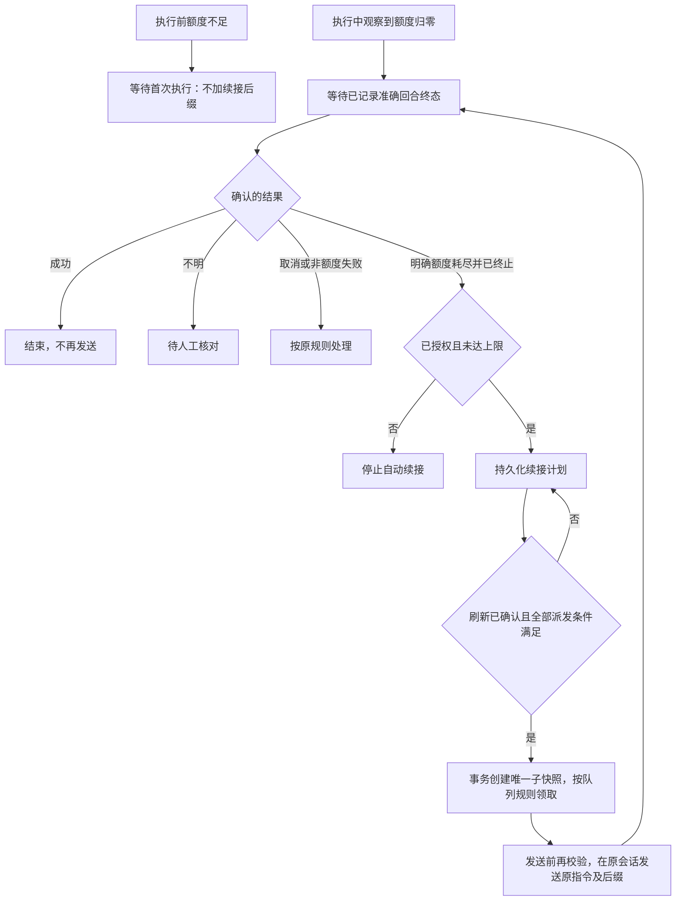

# 需求更新：任务管理、项目与会话选择及额度中断续接

文档版本：v0.4.0 需求及实施状态（整合 U04 无项目／多文件夹场景，含 U06、U07）；日期：2026-10-27。

现有基线：完整客户端 0.3.0，主分支基线提交 `496b799164bd71f8d7023432e11e97e08613c730`。

状态：**本开发分支已实现 U01、U02、U03、U05、U06、U07 的核心能力并增加隔离验证；U04 部分实现，原生会话完整有效权限读取仍受本机协议能力限制。完整 0.4.0 尚未验收，自动续接默认关闭，程序版本保持 0.3.0。** 以下要求继续作为验收依据，实际验证范围见 [实施说明](IMPLEMENTATION-0.4.0.md)。

## 1. 本次更新目标

让零基础用户在新建任务时完成“选项目、选会话、选模型、写指令”，减少手填 ID 和路径，优先查看最新创建的任务，并在客户端分别设置五小时及周额度保留线；对已授权、已确认因账户额度耗尽而中断的任务，在额度刷新且条件满足后自动继续。

| 编号 | 用户需求 | 本期目标 | 当前基础与限制 |
| --- | --- | --- | --- |
| U01 | 读取 Codex 模型，做成下拉框 | 动态读取模型及推理强度，保存真实模型标识 | 已实现分页读取、账户来源范围、执行前模型及强度校验 |
| U02 | 自动生成任务 ID | 后台生成固定 ID，普通用户只填任务名称 | 已实现 UUID 与持久化创建请求去重；旧 ID／版本／历史保留 |
| U03 | 查询 Codex 侧栏项目 ID，先选项目名称再选任务名称 | 读取真实项目 ID/名称，按项目筛选 Codex 会话，形成二级选择 | 已实现实验协议 project/list、project/read 与 thread.projectId；本机只读验证通过，跨版本兼容待验收 |
| U04 | 取消续接手动目录输入，兼容无项目会话与多文件夹项目 | 区分项目归属、实际工作目录及文件访问范围；自动读取、只读展示并在后台校验完整执行环境 | 部分实现：续接目录只读；新会话显式授权范围。原生完整有效权限未知时阻止执行，无文件夹官方项目仍受限 |
| U05 | 额度归零后等待，重置后重新输入被截断任务并追加指定文字 | 经确认的额度中断产生独立续接计划；在原会话发送原始指令快照并追加“请继续这个被截断的任务” | 已实现默认关闭的授权策略、证据、子运行、去重、原始快照与后缀、上限和停止；真实发送未验证 |
| U06 | 任务管理列表增加时间倒序选项，新任务在前 | 提供按创建时间倒序／正序切换，默认最新创建的任务在前 | 已实现服务端排序后分页、稳定并列排序和本地配置范围偏好 |
| U07 | 在客户端手动修改五小时和周额度保留线 | 设置页提供两项独立百分比，完成校验、持久化及生效状态展示 | 已实现独立表单、整体保存、并发校验、旧值兼容与当前生效值；安全重启后仍暂停 |

### 1.1 名称约定

- **本地调度任务**：用户在本客户端保存的任务定义，有任务名称、任务 ID、版本和指令。
- **Codex 会话／任务**：Codex 中已有的聊天。本次二级下拉里的“任务名称”指它的会话标题，不是另一个本地调度任务。
- **官方项目**：官方 Codex 侧栏中的项目实体；项目 ID 必须来自可验证的数据源。项目可无关联文件夹，也可关联多个文件夹；会话也可明确不属于任何项目。
- **项目关联文件夹**：项目挂载的零个或多个业务文件夹，与主文件夹、各文件夹访问权限分别记录，不能等同于一个必填路径。
- **实际工作目录**：当前会话执行命令、解析相对路径等使用的位置。已有会话的实际目录不一定等于项目现在的主文件夹，也不能用它推算官方项目 ID。
- **文件访问范围**：本次任务经确认允许读取、写入的范围，与文件夹是否关联到项目分别判断；关联多个文件夹不代表全部可写。
- **无项目与未知**：已确认无项目归属、已确认没有业务文件夹是有效状态；查询失败或字段缺失是未知状态，不能混为一谈。
- **续接运行**：原回合结束后，在同一会话中发送一条新的续接消息；不是让原回合在原位置无缝恢复。

建议界面字段名称为“Codex 项目”和“Codex 会话（任务）”，避免任务 ID、会话 ID 混淆。

## 2. 范围与能力核实

### 2.1 已确认的接入基础

基线环境中，已通过只读查询验证会话目录可返回会话名称及工作目录，模型目录可返回显示名称、默认标记及支持的推理强度。官方接口提供 `thread/list`、`thread/read` 和 `model/list`；实现时须再次核对目标机器的 CLI 版本及实际协议。

来源：[OpenAI App Server 文档](https://learn.chatgpt.com/docs/app-server)。这些基础查询的成功不等于本次新功能已实现，也不构成真实任务执行验收。

### 2.2 官方项目 ID 是必须核实的独立能力

U03 的第一步必须是“官方项目 ID／名称读取验证”，交付以下证据：支持的 CLI/客户端版本、合法数据来源、字段含义、身份范围、项目与会话的关联方式，以及只读查询结果。

本次核对本机 CLI `0.164.0-alpha.11.1` 的完整实验 JSON Schema，并通过启用实验能力的只读连接确认 `project/list`、`project/read` 和 `thread.projectId`。已读到官方项目实体及多个关联文件夹，不用路径推算 ID。该接口属于实验能力，其他版本拒绝接口时显示明确错误；不能由此承诺跨版本稳定性。一般接入依据见 [App Server 文档](https://learn.chatgpt.com/docs/app-server)，完整有效权限仍需分别验证。

必须遵守：

1. 优先采用有依据的官方接口或受支持的数据访问方式，不在需求中虚构一个已存在的项目查询方法。
2. 不把目录名、路径哈希、会话 ID 或随机 UUID 当作官方项目 ID。
3. 不抓取浏览器 Cookie、复制访问令牌，或修改官方客户端的私人数据库来实现项目同步。
4. 如只可读取官方客户端私有缓存，须单独评估支持范围、权限和版本兼容性，不能默认作为稳定接口。
5. 无可靠数据源时，明确显示“当前版本暂不支持读取官方项目”，U03 保持未完成。
6. 可以另行提供明确标注的“本地目录分组”供兼容使用，但它不算“官方项目 ID 查询”验收通过。

官方项目和本机文件夹不是必然一一对应关系；官方产品可存在无文件夹或多个文件夹的项目。[官方项目说明](https://learn.chatgpt.com/docs/projects)

项目 ID、项目关联文件夹、会话实际工作目录及有效权限是分别需要验证的能力。能读取 `thread.cwd` 不代表能完整读取其他文件夹及权限；U04 的无项目、多文件夹接入也须提供目标版本的能力证据。受控本地目录只提供执行环境，不能据此宣称已创建或关联官方侧栏项目。

### 2.3 本期边界

本期延续单个活动账户、本机 Windows 客户端和串行执行，将无项目会话及多文件夹项目纳入 U04 目标；接入能力未经验证时如实报告不支持。读取目录列表、展开下拉或预览任务只进行元数据查询，不创建、恢复或中断会话，不发送指令。

“在已有项目中新建会话”保留为正常使用入口。“创建新本地项目文件夹后新建会话”可作为后续增强；是否创建官方侧栏项目实体另行核对接口，不用创建本地文件夹替代它。

## 3. 界面与使用流程

### 3.1 基本布局

```text
任务名称           [用户填写]
执行方式           [继续已有会话 / 新建会话]

继续已有会话：
  Codex 项目       [项目名称 / 已确认无项目归属] [刷新]
  Codex 会话（任务）[对应会话名称下拉]
  项目归属         [自动读取，只读；未知时明确提示]
  关联文件夹       [逐项展示；可明确为无业务文件夹]
  实际工作目录     [从会话读取，只读；主文件夹另行标记]
  有效访问范围     [各目录读取 / 写入权限，只读展示]

新建会话：
  工作方式         [无项目 / 已有项目 / 本地文件夹模式]
  无项目           [不要求选择业务文件夹]
  已有项目         [读取关联文件夹、主文件夹及可用权限]
  本地文件夹模式   [选择文件夹；不冒充官方项目]
  执行环境预览     [默认工作目录及各文件夹的授权范围]

模型               [Codex 返回的模型列表 / 默认策略]
推理强度           [随模型变化的可选列表]
指令               [多行编辑]
文件访问权限       [默认只读 / 允许修改已确认范围；预览逐项目录]
额度耗尽后自动继续  [开关，默认关闭]
自动继续次数上限    [开启后显示]

高级信息           [自动任务 ID、会话 ID、来源等，只读]
                    [保存任务] [取消]
```

这是需求示意，不表示当前版本已出现这些控件。

### 3.2 按场景确定工作路线

| 路线 | 主要选择 | 目录行为 | 实际创建／续接时机 |
| --- | --- | --- | --- |
| 继续已有会话，含无项目会话 | 项目或已确认无项目归属 → 会话 | 自动读取完整环境，只读展示，不手填目录 | 执行或派发时续接准确会话 |
| 无项目新建会话 | 选择无项目方式、填写指令 | 不要求业务文件夹；后台解析已验证的受控执行环境 | 执行或派发时新建会话，实际官方归属以接入能力为准 |
| 已有项目中新建会话 | 选择项目 | 读取多个文件夹、主文件夹和权限，确认执行范围 | 执行或派发时新建会话 |
| 本地文件夹模式新建会话 | 明确选择本地文件夹模式及已有文件夹 | 预览实际工作目录及权限，不伪造官方项目 ID | 执行或派发时新建会话 |
| 新本地项目中新建会话，后续增强 | 选择父目录、填写新文件夹名称 | 用户明确创建文件夹后使用 | 执行或派发时新建会话 |

保存任务只保存配置及指令，不提前创建 Codex 会话。文件夹创建是单独的明确操作，初始化 Git 或生成项目模板应有独立选项。

### 3.3 任务管理列表

```text
搜索任务 [关键词]   状态 [全部 / 启用 / 停用]
排序     [创建时间倒序（最新在前） / 创建时间正序（最早在前）]

任务名称    创建时间    状态    操作
最新任务    ……          ……      ……
较早任务    ……          ……      ……
```

排序控件用于本地调度任务列表，详细规则见第 9 节 U06。

### 3.4 客户端额度设置

```text
设置 → 额度保留线

五小时额度保留线    [10] %
周额度保留线        [10] %

说明：任一窗口剩余比例小于或等于其保留线时，等待后续额度查询。
      0% 表示不额外保留；真实耗尽或额度未知时仍不能提交。

当前生效值          五小时 10% · 周 10%
已保存值            五小时 5% · 周 20%（待重启后台）
                    [保存设置] [重启后台并应用]
```

数值为界面示例，不是个人账户数据。用户无需修改 JSON 或使用终端；保存与安全重启规则见第 10 节 U07。

## 4. U01：动态模型下拉框

### 功能要求

1. 从当前连接配置对应的 Codex 读取模型目录，处理分页，默认展示适合普通选择器的非隐藏条目。
2. 显示模型名称和默认标记，保存接口要求的真实模型标识；不以显示名称作为执行参数。
3. 选中模型后，推理强度只展示该模型支持的选项；切换模型时清理或提示不兼容的强度选择。
4. 保留“使用 Codex 默认配置”选项，并在预览中明确它是一种默认策略，不是已固定的具体模型。
5. 如提供“沿用原会话模型”，必须有可验证的会话配置依据。模型目录不能证明某个聊天当前选中了哪个模型。
6. 加载、空列表、离线、未登录和读取失败都有明确状态；失败时不伪造模型、不静默替换已保存模型。
7. 账户、Codex 数据目录或连接来源改变后，清除不再适用的缓存并丢弃旧响应。
8. 已保存及已入队任务继续遵守版本和快照规则。模型目录更新不改写旧快照。
9. 模型在目录中出现不保证执行时有权限或额度；发送前仍接受账户、额度和服务端校验。

### 验收结果

能够按模型名称选择，并保存正确标识；推理强度联动；修改前后旧运行快照保持不变；目录失效时明确提示用户处理。

## 5. U02：自动生成任务 ID

### 功能要求

1. 用户新建任务只需填写任务名称，任务 ID 由后台在首次成功保存时生成。
2. ID 使用可靠的唯一标识方案，例如 UUID；不能仅由名称、时间戳或列表序号拼接。
3. 任务名称可以重名、可以修改；任务 ID 保存后固定，作为版本、运行和历史的关联键。
4. 普通表单隐藏 ID 输入；高级信息可查看和复制，但不允许直接编辑。
5. 创建请求需有请求级幂等标识。重复点击或保存响应丢失后重试，应返回同一个创建结果，不能因为生成新 UUID 而创建两项任务。
6. 历史手工 ID、已归档任务 ID、任务版本、队列、运行及外部引用全部保留，不批量重命名。
7. 自动队列原有“任务 ID＋版本号”去重规则继续有效。
8. 新 ID 生成不代替 revision 检查，也不决定所用账户、会话、模型或优先级。

### 验收结果

零基础用户无需填写 ID；并发创建和网络重试不产生错误重复项；旧数据正常查询、修改和追溯。

## 6. U03：官方项目与会话二级下拉

### 6.1 项目选择

- 按 2.2 节先完成官方项目能力验证。列表至少提供真实项目 ID、名称和来源；可用时提供工作目录及其他可验证信息。
- 项目名称用于显示，项目 ID 用于关联；同名项目通过路径或短 ID 区分。
- 不能获取真实项目 ID 时显示不支持状态；兼容的本地目录分组必须有不同标签和来源类型。
- 经来源确认无项目归属的会话进入“无项目会话”分组；该分组不是一个伪造的官方项目，归属未知另行标记。
- 本期只允许选择当前接入方式能处理的本机会话。远程环境或缺少已验证执行上下文时给出不支持原因；不能仅因没有业务文件夹就判定会话无效。

### 6.2 会话选择

- 第一级选项目后，第二级只列出经数据源确认属于该项目的会话；不能仅因文件夹相同就断言属于同一个官方项目。
- 显示会话名称、更新时间、必要的目录及短 ID，支持搜索、分页和刷新。
- 保存准确的 `thread.id`，不能使用会话标题、分享链接，或把根会话的 `sessionId` 当作分支会话 ID。
- 无名称时显示“未命名会话＋短 ID”，不能为补标题擅自读取或展示完整消息正文。
- 更换项目或切换无项目分组时，清除原会话、自动目录列表及权限预览；异步请求返回后重新检查当前选择，丢弃过时结果。
- 归档会话、不可读取会话、已删除项目等情况明确展示，不能退回到“最新聊天”。
- 列表选择不代表执行授权；预览、保存和执行前仍需校验所属来源及准确 ID。

### 6.3 同步与身份边界

项目和会话数据必须与所配置的账户、Codex 数据目录及连接来源绑定。切换账户或配置后不得沿用旧账户的选择结果。

侧栏名称变化可更新显示标签，但不能自动把已入队任务改为另一个项目或会话。已有快照保留原始绑定和可追溯来源。

### 验收结果

在目标机器真实读取官方项目名称及 ID，并正确列出其会话；同名项不混淆；无可靠接口时准确报告能力缺失，不误报 U03 已完成。

## 7. U04：统一执行环境与续接目录自动读取

本节合并“取消继续会话时的手动目录输入，但保留自动读取后的目录展示和后台校验”、无项目会话和多文件夹项目三项要求。不能仅隐藏原来的输入框，也不能继续把项目、执行目录和权限都塞进一个必填 `projectDir`。

### 7.1 场景规则

| 场景 | 用户是否选择业务目录 | 自动读取／解析及展示 | 后台要求 |
| --- | --- | --- | --- |
| 新建无项目会话 | 不强制选择 | 显示无项目方式、已验证执行环境及实际文件访问范围 | 如底层需要工作目录，解析受控上下文并记录来源，不能任意继承调度器启动目录 |
| 已有项目中新建会话 | 选择项目即可，多个文件夹逐项确认 | 展示项目全部可验证关联文件夹、主文件夹及权限 | 默认工作目录采用可验证主文件夹；只授予本次任务明确确认的范围 |
| 继续有项目会话 | 不提供手填路径或目录选择按钮 | 读取原会话实际目录、项目关联文件夹、主文件夹和有效权限，只读展示 | 使用原会话实际执行上下文，不用项目当前主文件夹覆盖它 |
| 继续无项目会话 | 不要求手填或补选目录 | 展示已确认无项目归属；有实际目录则只读展示，受控环境则说明管理来源 | 验证记录中的原环境及权限；无业务文件夹不等于环境未知 |
| 必要信息无法读取或当前协议不支持 | 不允许用手填路径强行绕过 | 显示未知字段、失败或不支持原因及处理建议 | 阻止发送，不伪装成“无项目”或擅自选择其他目录 |

“无项目”表示没有官方项目归属，不保证底层没有工作目录或产物目录；“无业务文件夹”“实际工作目录”和“结果保存位置”分别展示。受控环境也必须有可验证的定位和权限来源，不能以省略请求参数任由子进程继承当前仓库目录。

已关联官方项目、但经确认没有业务文件夹时，保留其项目归属，并采用经过验证的受控执行环境；不强制补选文件夹，不伪造主文件夹，也不把它改标为无项目会话。

### 7.2 继续会话的自动读取与只读展示

1. 选择准确会话后，只读读取其所属来源、账户范围、项目归属、实际工作目录及可验证文件访问范围；不使用恢复或发送操作来探测环境。
2. 移除续接表单中的手动路径输入和目录选择按钮。展示关联文件夹列表、主文件夹标记、原会话实际目录及每个范围的读写权限，并注明来源。
3. 原会话目录与项目主文件夹不同，例如位于项目子目录或隔离工作树时，分别展示；只有关联关系有证据时才支持，不能猜测映射，也不能因两者不完全相等机械报错。
4. 无项目会话可进入同一选择流程；区分已确认无项目、已确认无业务文件夹、由后台管理的执行环境与查询未知。无法验证的空字段不能当作合法无目录模式。
5. 编辑历史续接任务时，按原会话及来源重新核实环境。失败时保留原数据和草稿并显示错误，不填入当前进程目录、登录数据目录或聊天记录目录来替代。

### 7.3 后台校验与权限边界

1. 保存及创建入队快照前，验证准确会话可读取、来源与账户一致，以及所需环境信息完整。对具体目录检查存在性、可访问性和实际定位；对受控环境核验其稳定标识及实际定位依据。
2. 数据中分别保存可为空且带明确状态的官方项目绑定、关联文件夹列表、主文件夹、原会话实际工作目录、权限范围和读取来源。无项目必须是有证据的状态，不能只将旧单目录字段改成可空就宣称支持。
3. 执行前再次读取准确会话和必要环境，核对快照中的绑定及授权范围，并检查活动状态和共享执行权。规范化路径时遵循目标文件系统的大小写及目录联接规则，不能仅比较用户输入文字。
4. 项目名称或文件夹展示顺序改变不代表换了执行环境。实际目录、关键文件夹关联、主目录或有效权限发生变化时提示重新核对；不得静默更新已入队快照、改发其他会话或改用新的主文件夹。
5. 多文件夹关联不自动赋予全部写权限。默认只读；需要写入时展示并保存本次明确授权的范围。继承范围必须可验证，不能扩大到未授权目录，不能用公共父目录代替多个精确范围。
6. 某个必要文件夹缺失、权限无法读取、环境不受当前协议支持或关键绑定不一致时阻止发送，指出具体字段和目录。不能退回到单一主目录并声称已完整支持原多文件夹环境。
7. 执行器只使用持久化、已验证的环境快照；服务端返回的实际环境作为运行来源另行记录。发现差异时阻断，不能改写不可变快照来消除不一致。

### 7.4 兼容、恢复与验收

- 旧版本 `projectDir` 作为原先明确授权的单目录环境保留，历史任务、运行、版本及权限不能重写，也不能由路径推造官方项目 ID 或多文件夹关联。
- 新环境模型通过追加迁移及带状态的读取结果实现；发现损坏或无法确定旧环境时继续核对，不创建空库或猜测目录。
- 重启恢复和 U05 额度中断续接均复用已记录准确环境。只读核对、工作目录或受控环境定位、授权范围的保护继续有效，不能因支持无项目而放松。
- 新建任务保存、目录预览和列表查询不提前创建或恢复远端会话。无项目及多文件夹能力须分别验证；尚无可靠来源时保持未完成并明确说明。
- 本项目同一数据库内的互斥继续保留；对独立 Codex 客户端的并发操作不能宣称有跨客户端原子互斥，应提示用户避免同时向同一聊天发送消息。

验收须覆盖无项目及多文件夹的新建／续接；续接无需任何手填目录，仍可只读核对实际环境和权限，且不会错用目录或扩大文件访问范围。

## 8. U05：额度中断后的自动续接

### 8.1 用户能看到的行为

新建／编辑任务提供“额度耗尽后自动继续”开关，默认关闭；用户开启并保存后，其策略进入本次执行的不可变快照。历史任务迁移时保持关闭。

开启时展示完整续接消息预览和次数上限。建议默认最多自动继续 3 次，可配置；0 表示关闭，不提供不受约束的无限重发。

修改任务开关影响后续执行快照，不改写已有运行的策略。对已经存在的续接链，界面须提供独立的停止操作，并清楚显示其当前授权状态。

因额度中断进入等待后，界面显示原因、原运行、原会话、已确认回合、次数和下一步条件，并提供“停止此任务的自动续接”。

无人值守继续需要调度进程运行且派发允许。手动执行不会隐式启动调度或恢复整条队列；条件缺失时明确显示“等待启动调度／恢复派发”。

### 8.2 必须区分三种情况

| 情形 | 行为 |
| --- | --- |
| 执行前额度已经为零或不足，尚未发送 | 等待首次执行；满足条件后发送原始快照，不追加续接后缀 |
| 执行中查到额度为零，但原回合还未确认结束 | 等待原回合结果；仅凭读数不能认定任务被截断，也不能自动中断或另发一条 |
| 原准确回合已确认因账户额度耗尽而终止 | 满足本节全部条件后，建立一次已授权的续接计划 |

若原回合随后成功，即使期间观察过额度归零，也不得再发续接。各窗口当前生效的保留线仍有效，独立设置见 U07；默认保留 10% 时，新任务可能在归零之前就进入等待。

### 8.3 “确认额度中断”的证据

自动续接至少需要：

1. 运行来自真实 Codex，且原始来源、账户、准确执行环境（实际工作目录或受控环境定位及权限）、会话 ID 和准确回合 ID 已持久化。
2. 有可信的准确回合终态，证明该回合已结束，而不是连接断开或取消请求刚被接收。
3. 可识别的结构化错误明确指向账户额度耗尽，并有相关额度窗口的真实完整查询证据。
4. Codex 内部重试已经结束；一次中间错误通知不能当作终止依据。
5. 任务快照明确允许自动继续，用户未停止该链，且未超过次数上限。

不能只匹配消息中“额度”“限制”等文字。普通速率限制、上下文长度、会话预算、网络故障、主动取消、超时、审批或输入请求不自动归类为账户额度中断。

0.3.0 目前会把部分回合失败归为通用失败；实现 U05 时必须先补充终态和错误分类的持久化白名单。旧记录缺少证据时继续人工核对，不能从旧错误文本推测后补授权。

### 8.4 等待重置与允许派发分别判断

续接条件必须同时成立：

- 原准确回合的额度中断已确认，相关执行权已按正常终态流程处理。
- 当前仍是原来源和原账户，项目归属状态、准确会话、原实际目录或受控环境及授权范围与已记录绑定一致，遵循 U04。
- 发生了持久化、可去重、与原耗尽窗口相关的新刷新证据。
- 新鲜完整查询确认所有相关窗口可用，各窗口剩余比例分别超过对应的当前生效保留线；缺失窗口、过期或查询失败仍是未知。
- 调度已运行、用户允许派发，没有其他待核对阻塞，且能取得与手动执行共用的执行权。
- 没有发现用户或其他客户端在原会话中新增了与本续接计划冲突的回合。

短窗口刷新而周窗口仍耗尽时继续等待。不能用本地倒计时、预计重置时间、单次比例上升或其他窗口刷新代替上述证据。

已确认额度中断且策略有效时，应进入可自动等待的续接分支，不能因为原实现“失败即暂停”而永久无法继续；用户主动暂停、重启后的初始暂停和异常阻塞仍优先。

### 8.5 续接消息的准确内容

在**原会话**发送一条新消息，使用最初触发这条续接链的原始指令快照，末尾换行附加固定文字：

```text
【原始指令快照，保持原文】

请继续这个被截断的任务
```

生成规则为“链的原始指令快照＋两个换行＋固定后缀”。后缀必须为 `请继续这个被截断的任务`，不擅自改写。

连续多次额度中断时，始终从链的原始指令生成，不能从上一轮生成的续接消息继续追加，造成后缀不断叠加。不自动附带整段聊天记录或输出，也不改用用户后来编辑的新指令。

沿用原任务的权限、完整执行环境、优先级和可验证执行配置；无项目及多文件夹按 U04 核对，不用一个新目录替代。若使用默认模型，需记录实际执行模型，续接时核对其可用性。无法确认必要配置时暂停，不静默换模型或扩大权限。

### 8.6 独立子运行与防重复

1. 原运行保留真实终态、错误原因、部分输出和准确回合，不改回 queued，也不覆盖为新的结果。
2. 为续接创建独立子运行，保存根运行、父运行、父回合、原指令哈希、实际会话、续接次数和策略快照。
3. 每个已确认中断的父运行／父回合最多产生一个自动续接子运行。多次查询、多个刷新事件和多个进程不能重复创建。
4. 普通任务版本的入队去重保持不变；续接使用独立的唯一身份和约束，不能靠伪造任务新版本或换任务 ID 绕过去重。
5. 计划创建及幂等记录在同一事务保存；刷新消费、领取与执行权仍在同一事务中校验并保存。事务内不等待网络。
6. 续接沿用原优先级，进入正常串行队列，不抢占正在执行的任务；发送前重新验证账户、额度、完整执行环境和会话。
7. 发送结果不明时保存 needs_attention，暂停该链，不创建下一份尝试；不能宣称远端恰好执行一次。

### 8.7 并发、取消与重启

- 等待期间发现原会话有新的外部活动时，暂停该续接计划并提示核对。侦测新回合不能把核对目标替换成“最新回合”。
- 原会话仍忙时等待；无法可靠确认状态时保持阻塞。不能承诺对其他独立客户端实现完全原子互斥。
- 暂停派发会阻止续接领取；停止某条续接链会阻止后续自动生成和领取，不删除历史。
- 主动取消、审批和输入请求不触发额度续接。运行中取消仍等待准确终态，未知时转人工。
- 重启后恢复续接计划及去重记录，但调度保持暂停，用户恢复派发后再校验条件。
- 已领取或提交不明的记录不得因重启自动释放或重发；可安全恢复的未领取子运行复用原 ID。
- 达到次数上限时停止自动继续，展示累计次数和最后结果，由用户决定后续安排。

### 8.8 状态示意



自动续接是一条新的模型消息，不能保证模型不会重复先前的部分操作，也不会撤销已发生的修改。开启前应展示完整续接预览；涉及写文件时提醒用户保留项目备份，并明确此风险与本地消息去重的区别。

## 9. U06：任务列表按创建时间排序

### 功能要求

1. 任务管理页提供清晰可见的排序下拉框，包含“创建时间倒序（最新在前）”和“创建时间正序（最早在前）”。首次使用默认倒序。
2. 新旧以任务首次保存成功的 `createdAt` 为准；编辑、启停、入队或运行不能改变创建时间，不能按任务 ID、名称、更新时间或运行时间推断新旧。
3. 列表展示创建时间。排序比较完整时间值，界面按本地时区显示；同一创建时间使用固定的任务 ID 次序打破并列，保证重复查询顺序稳定。ID 只用于并列排序，不代表时间。
4. 搜索和状态筛选仍有效。后端须对筛选后的完整结果集先排序、再分页，不能只倒排当前页；排序参数只接受约定选项。
5. 切换排序时返回第一页，保留搜索及状态条件；加载中、空列表和读取失败有清晰状态，迟到的旧请求不得覆盖新排序结果。
6. 新建成功后刷新列表并返回第一页；在倒序且符合当前筛选条件时，新任务应出现在相应的最新位置。被筛选排除时提示已保存，不能误报创建失败。编辑旧任务后，其位置仍由原创建时间决定。
7. 在当前本地客户端数据配置范围内记住排序偏好；刷新页面或重新打开客户端后恢复选择。没有偏好或偏好无效时使用默认倒序；保存偏好不生成任务新版本。
8. 本功能只改变任务管理列表展示，不改变队列优先级、FIFO 派发顺序、运行快照、执行权或自动调度规则。历史数据保留原创建时间；无法验证的异常时间显示“未知”并放在有效时间之后，不能补成当前时间冒充新任务。

### 验收结果

用户可切换最新／最早在前；多页和筛选后的结果保持全局时间顺序。新任务在倒序列表中优先展示，旧任务编辑后不被当作新任务，选择可恢复且队列执行顺序不受影响。

## 10. U07：客户端独立设置五小时和周额度保留线

### 10.1 设置入口与输入规则

1. 在客户端设置页提供“额度保留线”分区，分别显示“五小时额度保留线”和“周额度保留线”，使用百分比数字输入框。两项独立修改，不能修改一项时暗中覆盖另一项。
2. 新配置两项均默认 10%；已有配置按 10.5 节兼容，不能把用户已设置的值重置为默认值。提供“恢复默认值”操作，先更新表单草稿，用户保存后才写入配置。
3. 有效范围为 0%～100%，允许最多一位小数。空值、非数字、无穷值、越界或超出精度均拒绝保存并指出具体字段；前端和后端使用相同规则，不能静默截断或把空值当作 0。
4. 明确说明：0% 取消额外保留，但剩余为零仍被真实耗尽规则阻止；100% 会阻止该窗口下的新提交。保留线只控制提交前是否放行，不保证正在执行的任务不会继续消耗额度。

### 10.2 额度判定及窗口识别

- 每个相关窗口使用自己的生效阈值。剩余比例小于或等于对应阈值时等待；只有全部相关窗口均有效且超过各自阈值，才满足额度条件。
- 五小时和周窗口的归类以目标版本服务端返回的窗口类型、时长及可验证标识为依据，不能仅按 `primary`／`secondary` 的位置或本地倒计时猜测；保留线设置不能改变服务端刷新周期。
- 其他相关窗口不得被忽略：使用明确展示的兼容兜底保留线；无法可靠识别或读取必要窗口时，按未知处理并阻止提交。
- 真实耗尽、账户不一致、数据缺失或过期等阻塞继续有效。降低阈值不能绕过它们，也不能保证任务完成前不耗尽。
- 手动执行、自动队列和 U05 自动续接共用后台领域判定，客户端只展示结果，不另写一套放行算法。

### 10.3 保存、生效与运行中的任务

1. 两项设置作为一次整体保存，在后端完整校验、取得配置写锁、保留有效备份后原子替换；并发修改检查配置版本或等效标识，冲突时保留草稿，不覆盖他人更新。
2. 本期沿用“保存后重启后台生效”的配置流程。界面同时显示当前生效值、已保存值及“待重启”状态，不能保存成功就显示已经应用。
3. 提供客户端内的“重启后台并应用”入口，复用既有生命周期管理。有活动任务时按现有等待／请求取消流程处理，不能为应用设置强杀进程；结果不明时先核对。用户无需使用终端。
4. 保存设置本身不恢复派发、不重新发送任务、不自动重启。重启后队列保持初始暂停，用户恢复派发后，再以新的完整查询和新阈值判定是否允许领取。
5. 保留线属于当前服务配置；已排队但未发送的快照在下次预检时使用当前生效策略，原任务内容、版本和快照不变。已经提交的回合不因阈值修改而被中断或重新发送。
6. 运行记录保留当次判定使用的阈值及策略版本，历史记录不被新配置改写。领取与发送前的校验必须使用一致的有效策略，不混用新旧值。
7. 修改保留线不构成额度刷新证据。U05 因真实耗尽产生的续接计划仍须满足相关窗口刷新、全部窗口可用及其他授权条件；不能通过降低保留线绕过等待重置。

### 10.4 等待原因展示

概览、队列最近判定和手动执行详情应指出具体窗口及比较结果，例如“示例：五小时剩余 8%，已达到保留线 10%，等待额度”。多个窗口阻塞时逐项列出，并区分达到保留线、真实耗尽、未知和过期。

当前生效策略和待重启设置不能混淆；上例比较的是生效值。页面状态来自后台返回的结构化判定，不能根据倒计时自行宣布可执行。

### 10.5 旧配置兼容与验收结果

- 旧配置只有统一 `reservePercent` 时，五小时、周及其他相关窗口继承该值，行为保持一致；独立配置缺失的窗口继续使用这个兼容值。新建配置的兼容值默认 10%。
- 两个独立值均明确配置后，各自优先于兼容值；界面展示哪些值来自兼容配置，避免出现两个不明优先级的设置入口。
- 升级、导入和备份恢复须保留配置及其他业务数据。保存失败不写入部分设置，损坏配置不自动重置为空配置或默认值；恢复备份后重新校验并显示真实生效状态。

验收必须证明两个保留线可以完全通过 GUI 分别修改和保存，边界判定准确，重启后持久化及生效状态正确，旧配置兼容，并且手动、自动与续接使用同一规则。

## 11. 数据、隐私与迁移要求

建议新增的逻辑数据包括：

| 数据 | 必须保留的内容 |
| --- | --- |
| 目录能力与来源 | 支持哪些查询、CLI/适配器版本、真实官方项目或本地分组的来源类型 |
| 项目／会话绑定 | 真实项目 ID、名称及已知归属／明确无项目／未知状态，准确 thread ID 及来源身份范围 |
| 执行环境与文件权限 | 关联文件夹列表、主文件夹、原会话实际目录或受控环境标识及定位、逐范围权限、验证来源和版本；明确空值与未知的区别 |
| 模型选择 | 默认／显式／经验证继承策略、真实模型标识、推理强度及运行实际配置 |
| 任务创建幂等 | 创建请求标识与已生成任务 ID 的稳定关联 |
| 终止证据 | 准确回合、可信终态、白名单错误分类及相关额度窗口证据 |
| 续接计划与链 | 根／父／子运行关系、策略、次数、停止状态、刷新消费及去重标识 |
| 任务列表偏好 | 当前本地数据配置范围内的排序选项；与任务定义、创建时间和版本分开保存 |
| 窗口保留线配置 | 五小时／周独立值、兼容兜底值、已保存与生效策略版本，以及每次运行实际使用的判定值 |

字段名称是设计建议，不强制某一种数据库布局。实现须保留以下约束：

- SQLite 迁移在现有模式基础上追加，保留原任务 ID、版本、快照、输出、去重和执行权；不得损坏后重建空库。
- 任务编辑继续使用 revision 检查；已入队和已运行快照不可变。
- 额度监控检查点、刷新事件及刷新去重标识继续在同一事务保存；通知只触发完整查询，不能直接放行续接。
- 新的用户控制状态与旧快照分开保存，例如停止续接链不等于改写原快照。
- 缓存和业务选择保存在本机个人数据目录；界面可展示必要名称和路径，但默认日志、通知和脱敏诊断不包含私人会话名称、完整路径、指令或输出。
- 不把登录凭据、真实项目／会话元数据、任务内容或运行记录提交 Git。
- 管理接口继续仅绑定回环地址，读写有适当会话校验，写操作保留 CSRF；不提供任意 RPC 转发或通用文件访问入口。
- 模拟环境使用明确标识的替身数据；模拟额度不能放行真实任务或续接。

## 12. 验收清单

以下是未来实现的验收要求，不是本次文档生成已通过的功能测试。

| 编号 | 场景 | 必须结果 |
| --- | --- | --- |
| A01 | 模型目录正常、分页或隐藏条目 | 展示实际返回的可选项，保存正确模型标识 |
| A02 | 模型切换、强度不兼容、目录失效 | 正确联动或明确提示，不静默换模型，不改旧快照 |
| A03 | 普通新建任务及并发／失联重试保存 | 自动 ID 唯一，同一创建请求仅创建一次 |
| A04 | 旧 ID、归档任务、同名任务及修改名称 | 历史关联保持，改名称不改 ID |
| A05 | 官方项目真实 ID／名称查询 | 有合法可验证来源，不能用本地分组冒充完成 |
| A06 | 项目读取不支持或失败 | 明确能力缺失，其他功能可独立使用 |
| A07 | 项目切换、同名会话、分页、过时响应 | 二级联动正确，保存准确 thread ID，旧响应不覆盖 |
| A08 | 选中、浏览和刷新目录列表 | 不创建／恢复会话，不发送任务，不获取完整聊天正文补名称 |
| A09 | 续接自动读取实际目录、多个文件夹、权限及变化／缺失 | 无手填入口，环境只读展示，后台阻止错误目录或未授权范围执行 |
| A10 | 无项目／已有项目／本地文件夹模式新建及保存 | 无项目不强制业务目录，项目环境按来源解析；保存时不提前创建远端会话 |
| A11 | 执行前额度为零，尚未提交 | 等待后首次发原始指令，无续接后缀 |
| A12 | 执行中额度归零，但原回合未结束 | 不另发；随后成功则不创建续接 |
| A13 | 已授权且确认额度耗尽终止，相关窗口真实刷新且全部可用 | 原会话只新增一个子运行，消息为原始快照加准确后缀 |
| A14 | 短窗口刷新但周窗口不足、缺失窗口、过期或只到预计时间 | 继续等待，不伪造恢复 |
| A15 | 中间错误尚在内部重试、普通速率限制、上下文预算等 | 不误判为可自动续接的账户额度终止 |
| A16 | 断网、缺少准确回合、提交或取消结果不明 | needs_attention，不重发、不自动释放旧执行权 |
| A17 | 刷新事件重复、并发领取、保存后崩溃 | 同一父运行／回合最多一个子运行，互斥与去重有效 |
| A18 | 原指令后来被编辑，或连续发生多次额度中断 | 始终使用链的原始快照，系统后缀不叠加 |
| A19 | 等待中账户／来源、完整环境或权限变化，或发现外部新回合 | 阻止自动续接并提示核对，不用项目新主目录替换原会话环境 |
| A20 | 暂停、取消、停止续接或达到次数上限 | 不再领取／新增，当前运行仍按准确终态处理 |
| A21 | 重启时存在未领取、已领取及提交不明的续接 | 初始暂停；未领取复用 ID，其余按恢复规则核对 |
| A22 | 手动执行与续接同时发生，或调度未启动 | 共用执行权；不隐式恢复队列，显示实际阻塞条件 |
| A23 | 模拟模式、诊断导出、数据库迁移及备份恢复 | 不发送真实任务，不泄漏正文，保留旧数据 |
| A24 | 项目／会话／模型接口暂不可用 | 有加载、空、未知和失败状态，不猜默认 ID 或真实可用性 |
| A25 | 首次打开任务列表、切换正／倒序、相同创建时间及未知时间 | 默认最新在前，正序最早在前，并列顺序稳定，未知时间置后 |
| A26 | 多页任务、搜索、状态筛选及快速切换排序 | 完整结果先排序后分页，切换回第一页且保留筛选，旧响应不覆盖 |
| A27 | 新建任务、编辑旧任务、刷新／重启及后台派发 | 新任务按条件出现在最新位置，编辑不改创建时间，偏好可恢复，队列顺序不变 |
| A28 | GUI 分别修改五小时和周保留线 | 两项独立保存；任一窗口达到自身阈值均等待，只有全部满足才放行 |
| A29 | 剩余恰好等于阈值、0%、100%及小数阈值 | 相等仍等待；0% 不绕过耗尽，100% 不派发，小数比较正确 |
| A30 | 空值、越界、非数字、超精度及并发保存冲突 | 前后端拒绝无效输入，保留草稿与有效配置，无部分写入 |
| A31 | 保存、带活动任务的安全重启、应用及备份恢复 | 明确区分已保存／已生效；不强杀、不自动恢复派发，重启后值正确 |
| A32 | 旧统一值配置、部分独立值及未识别的相关窗口 | 正确继承兼容值，保留历史和配置，不遗漏其他窗口或放行未知数据 |
| A33 | 手动／自动／续接预检、修改阈值及等待原因 | 使用一致生效策略并留痕，显示具体阻塞窗口；修改不伪造刷新、不改写快照或重发 |
| A34 | 新建无项目会话，底层需要或不需要工作目录 | 不强制业务文件夹，准确解析并记录受控环境，不任意继承调度器目录或伪造官方归属 |
| A35 | 继续已确认无项目会话，以及项目／目录字段未知 | 有效无项目正常只读展示；未知明确阻断，不能靠手填或默认路径放行 |
| A36 | 多文件夹或零业务文件夹项目的新建／续接，实际目录不同于主文件夹 | 按证据展示及验证；无业务文件夹仍保留项目归属，子目录或工作树不被机械改成项目主目录 |
| A37 | 项目名称、文件夹顺序及关键环境在入队后改变 | 展示变化不误换绑定；关键变化须核对，快照不可变，不扩大到新增目录或公共父目录 |
| A38 | 缺少必要文件夹、有效权限无法读取或接口能力不足 | 指出具体原因并阻止发送，不能把多文件夹静默降为单目录并误报完整支持 |
| A39 | 单目录旧数据迁移、重启核对及额度中断续接 | 保留历史和原范围，不伪造项目；无项目／多文件夹均按准确已记录环境核对，不盲目重发 |

关键队列、刷新和续接测试使用可注入时钟及协议替身，覆盖边界、乱序、重复事件和故障注入。真实验证先只读；需要消费额度或修改项目时，另行取得针对明确任务和目录的授权，不为验收故意耗尽真实账户额度。

## 13. 分块实施顺序

| 阶段 | 交付 | 依赖与完成条件 |
| --- | --- | --- |
| 1：目录与能力适配 | 模型／会话只读领域接口，官方项目、无项目／多文件夹环境及权限的能力证据，来源与身份范围 | 先核对官方资料和本机协议；U03／U04 能力不足时如实报告，不虚构字段 |
| 2：任务与设置界面 | 自动 ID、创建幂等、模型联动、项目／会话选择，U04 统一环境模型和只读展示，任务排序、独立保留线 | 保留旧数据；无项目不强制目录；多文件夹及权限完整验证；续接无手填路径，其他筛选及设置规则兼容 |
| 3：额度中断证据 | 准确终态与白名单原因、窗口证据、用户授权策略快照 | 能可靠区分预检等待、额度终止、其他失败和未知结果 |
| 4：续接编排与持久化 | 根父子运行、次数限制、刷新幂等、事务领取、停止和重启恢复 | 先通过模拟的重复／并发／崩溃测试，再接入真实执行路径 |
| 5：端到端验收 | 全部适用清单、迁移、文档、打包和运行报告 | 清楚区分已实现、能力阻塞与正式发布待补证据 |

业务规则与状态放在领域层，外部 Codex 协议放在适配器；调度器只依赖领域接口。功能交付时同步更新用户手册、README、路线图和迁移说明。

## 14. 与既有规则的关系

本增量对“已授权、已确认额度中断”的运行增加独立续接计划；它不等于允许自动重发提交不明的任务。

真实额度、已知窗口、来源与账户、不可变快照、同库互斥、人工审批、取消终态、初始暂停和原回合恢复规则继续成立。不得用更换任务 ID、重置旧状态、自动批准请求或放宽身份校验来完成本需求。

关联基线：[产品需求](REQUIREMENTS.md)、[桌面需求](DESKTOP-CLIENT-REQUIREMENTS.md)、[自动调度](SCHEDULING.md)、[执行](EXECUTION.md)、[恢复](RECOVERY.md)、[路线图](ROADMAP.md)。
